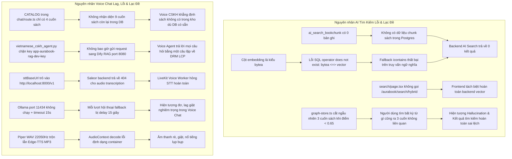

# BÁO CÁO ĐIỀU TRA TOÀN DIỆN: PHÂN HỆ AI TÌM KIẾM & VOICE CHAT (AURABOOK)

**Người thực hiện**: Teamwork Explorer Survey 2  
**Thời gian hoàn thành**: 2026-10-31T13:55:00Z  
**Mục tiêu**: Điều tra chi tiết cấu trúc mã nguồn, luồng dữ liệu end-to-end, nguyên nhân gốc rễ gây lỗi, phản hồi lạc đề, hallucination, lag và glitch âm thanh của phân hệ **AI Tìm Kiếm** và **Voice Chat** trong dự án Aurabook.

---

## 1. OBSERVATION (Quan sát thực tế & Bằng chứng mã nguồn)

### 1.1. Hiện trạng triển khai dịch vụ hệ thống
Kiểm tra qua `docker ps` và `Get-NetTCPConnection`:
- **Đang chạy**:
  - `aurabook-backend` (Django GraphQL & REST, port 8000)
  - `aurabook-postgres` (PostgreSQL 16 with pgvector, port 5432, database `aurabook_db`)
  - `aurabook-redis` (Redis 7, port 6379)
  - `aurabook-celery` (Celery worker)
  - `aurabook-dashboard` (Saleor Dashboard, port 9000)
  - `aurabook-mailpit` (Mail server, port 8025)
  - Storefront Next.js (`frontend`, port 3000)
  - System Admin Portal (`admin`, port 3001)
  - Piper TTS Engine (`aurabook_piper_tts_server.py`, port 5050 - HTTP 200 `isPiperLoaded: true`)
- **Chưa chạy / Offline**:
  - Port 11434 (`ollama` local LLM server)
  - Port 7880 (`livekit-server` WebRTC)
  - Port 8080 (`dify` Core RAG Nginx/API)
  - Port 8088 (`readium-lcp` DRM reader gateway)

---

### 1.2. Kho sách thực tế trong Cơ sở dữ liệu (Saleor DB) vs. Cấu hình AI
Truy vấn trực tiếp PostgreSQL `aurabook_db`:
```bash
docker exec aurabook-postgres psql -U aurabook_user -d aurabook_db -c "SELECT id, name, slug FROM product_product;"
```
Kết quả ghi nhận **13 ấn phẩm** có sẵn trong cơ sở dữ liệu:
1. `dac-nhan-tam` (Đắc Nhân Tâm)
2. `bon-thoa-uoc` (Bốn Thỏa Ước)
3. `sapiens-luoc-su-loai-nguoi` (Sapiens: Lược Sử Loài Người)
4. `tri-tue-do-thai` (Trí Tuệ Do Thái)
5. `10-dieu-tao-nen-so-phan` (10 Điều Tạo Nên Số Phận)
6. `bi-mat-cua-mot-tri-nho-sieu-pham` (Bí Mật Của Một Trí Nhớ Siêu Phàm)
7. `cay-cam-ngot-cua-toi` (Cây Cam Ngọt Của Tôi)
8. `chien-tranh-tien-te-tap-1` (Chiến Tranh Tiền Tệ - Tập 1)
9. `chien-tranh-tien-te-tap-2` (Chiến Tranh Tiền Tệ - Tập 2)
10. `chien-tranh-tien-te-tap-3` (Chiến Tranh Tiền Tệ - Tập 3)
11. `chu-nghia-khac-ky-phong-cach-song-ban-linh-va-binh-than` (Chủ Nghĩa Khắc Kỷ)
12. `cach-nghi-de-thanh-cong` (Cách Nghĩ Để Thành Công)
13. `tu-duy-nhanh-va-cham` (Tư Duy Nhanh Và Chậm)

Tập tin tri thức `ecommerce-ai-platform/data/graphrag_store.json` (dung lượng 6.1MB, 381 nodes) cũng ghi nhận đầy đủ 13 ấn phẩm trên.

---

### 1.3. Phân hệ AI Tìm Kiếm (AI Search) — Quan sát chi tiết

#### A. Backend Django (`backend/aurabook_apps/ai_search/`)
1. **Model `BookChunk`** (`backend/aurabook_apps/ai_search/models.py` lines 11-24):
   ```python
   class BookChunk(models.Model):
       id = models.UUIDField(primary_key=True, default=uuid.uuid4, editable=False)
       product_id = models.CharField(max_length=255, db_index=True)
       product_slug = models.CharField(max_length=255, db_index=True)
       chunk_index = models.PositiveIntegerField()
       chunk_text = models.TextField()
       embedding = models.BinaryField(null=True, blank=True)  # <-- Cột BYTEA
   ```
   - Schema trong PostgreSQL thực tế: Cột `embedding` là kiểu dữ liệu `bytea`.
   - Số lượng bản ghi hiện tại trong bảng: **0 bản ghi** (`SELECT count(*) FROM ai_search_bookchunk;` trả về `0`).

2. **Truy vấn Hybrid Search RRF** (`backend/aurabook_apps/ai_search/search.py` lines 38-67):
   ```python
   # Vector search via raw SQL (pgvector)
   with connection.cursor() as cursor:
       cursor.execute(
           """
           SELECT product_id, product_slug, chunk_text, chunk_index,
                  (embedding <=> %s::vector) AS distance
           FROM ai_search_bookchunk
           WHERE embedding IS NOT NULL
           ORDER BY distance ASC
           LIMIT 50
           """,
           [vec_str],
       )
   ```
   - **Lỗi nghiêm trọng**: `embedding` là `bytea`, trong khi `%s::vector` là kiểu `vector`. PostgreSQL báo lỗi: `operator does not exist: bytea <=> vector`.
   - Try-except block ở dòng 65 bắt ngoại lệ và ghi log: `logger.warning("pgvector search failed, using fulltext only: %s", exc)`.
   - Nhánh fallback dùng fulltext search:
     `fulltext_results = list(BookChunk.objects.filter(chunk_text__icontains=query)...)`
     Sử dụng `icontains` (so khớp chuỗi con chính xác). Vì bảng có 0 bản ghi, kết quả trả về luôn là rỗng (`total: 0, results: []`).

3. **Gemini Client** (`backend/aurabook_apps/ai_search/gemini_client.py` lines 21-32):
   - `get_text_embedding()`: Nếu `GEMINI_API_KEY` không cấu hình hoặc kết nối Google API thất bại, hàm trả về mảng zero `[0.0] * 768`.

4. **Celery Task Vectorization** (`backend/aurabook_apps/ai_search/tasks.py` lines 67-76):
   - Đóng gói vector: `struct.pack(f"{len(embedding)}f", *embedding)` rồi lưu vào trường `BinaryField`. Việc này tạo ra dữ liệu nhị phân thô (bytea), không thể lập chỉ mục IVFFlat hay HNSW của pgvector.

#### B. Frontend Search (`frontend/src/`)
1. **API Route `/api/search/ai`** (`frontend/src/app/api/search/ai/route.ts` lines 16-23):
   - Thực hiện HTTP POST đến `${BACKEND_INTERNAL_URL}/aurabook/search/hybrid`.
   - **Thực tế**: File này là một endpoint độc lập, **hoàn toàn không được gọi** bởi giao diện người dùng chính (`search-bar.tsx` và `search/page.tsx`).

2. **Search Bar Component** (`frontend/src/ui/components/nav/components/search-bar.tsx` lines 65-74):
   - Khi người dùng gõ từ khóa, gọi API `/api/ai/graphrag/search?query=...`.

3. **Trang Tìm Kiếm Chính** (`frontend/src/app/(storefront)/[locale]/[channel]/(main)/search/page.tsx` lines 102-143):
   - Bước 1: Gọi `searchProducts({ query, ... })` qua Saleor GraphQL (`SearchProductsDocument`). Đây là tìm kiếm từ khóa thông thường của Saleor.
   - Bước 2: Nếu kết quả bằng 0, fallback sang `graphRAGStore.searchProductsByContext(query, ...)`.
   - **Hoàn toàn không kết nối tới Backend AI Search (`/aurabook/search/hybrid`) hay Dify RAG (port 8080)**.

4. **Cơ chế gợi ý và sinh ảo giác trong `graph-store.ts`** (`frontend/src/lib/graphrag/graph-store.ts` lines 1405-1410):
   ```typescript
   // Nếu không có sách khớp trực tiếp (như tìm Hồ Chí Minh, nấu ăn...):
   // Lấy 3 cuốn tiêu biểu trong kho sách để người dùng có thể tham khảo mở rộng
   if (finalMatches.length === 0 && scoredBooks.length > 0) {
       finalMatches = scoredBooks.slice(0, Math.min(3, scoredBooks.length));
   }
   ```
   - **Nguyên nhân gốc rễ sinh kết quả sai/lạc đề**: Bất cứ khi nào người dùng tìm kiếm một từ khóa không có trong đồ thị hoặc tìm kiếm theo câu hỏi tự nhiên không khớp từ khóa cơ bản, thuật toán tự ý cắt 3 cuốn sách đầu tiên trong danh sách gán nhãn làm kết quả gợi ý.
   - Tập `INITIAL_GRAPH_DATA` trong `graph-store.ts` fix cứng chỉ có 4 cuốn sách (Đắc Nhân Tâm, Trí Tuệ Do Thái, Bốn Thỏa Ước, Sapiens), bỏ rơi các cuốn sách khác trong Saleor DB.

---

### 1.4. Phân hệ Voice Chat — Quan sát chi tiết

#### A. Sự phân mảnh kiến trúc (Dual Architecture Mismatch)
Hệ thống Aurabook đang có **2 kiến trúc Voice Chat hoàn toàn tách rời nhau**:
1. **Kiến trúc A (Giao diện Web Storefront trực tiếp)**:
   - File: `frontend/src/ui/components/voice-agent/voice-agent-widget.tsx` (Widget nổi CSKH màu tím ở góc phải màn hình).
   - Backend API: `frontend/src/app/api/ai/voice-agent/chat/route.ts` (Next.js server-side route).
   - Âm thanh: Trình duyệt nhận dạng bằng Web Speech API (`webkitSpeechRecognition`), gửi text lên `/api/ai/voice-agent/chat`, route này gọi Piper TTS (`http://localhost:5050/api/tts`) lấy chuỗi `audioBase64` rồi phát qua `AudioContext` của trình duyệt.
2. **Kiến trúc B (LiveKit WebRTC Worker độc lập)**:
   - File: `ecommerce-ai-platform/voice-agent/backend/vietnamese_cskh_agent.py`.
   - Máy chủ: LiveKit Server (port 7880), kết nối STT -> LLM -> TTS qua giao thức WebRTC thời gian thực.
   - Giao diện: `ecommerce-ai-platform/voice-agent/frontend` (Next.js port 3001). **Tuy nhiên**, script khởi động `START_AURABOOK.ps1` và `START_ALL.ps1` lại dùng port 3001 cho thư mục `admin`, khiến giao diện LiveKit không được chạy mặc định.

#### B. Lỗ hổng tại Storefront Voice Chat (`/api/ai/voice-agent/chat/route.ts`)
1. **Fix cứng mảng `CATALOG` 4 cuốn sách** (lines 50-191):
   - Mảng `CATALOG` chỉ khai báo 4 cuốn: Đắc Nhân Tâm, Bốn Thỏa Ước, Sapiens, Trí Tuệ Do Thái.
   - Khi khách hàng hỏi mua hoặc hỏi thông tin về 9 cuốn sách còn lại có thật trong cơ sở dữ liệu (ví dụ: *Chiến Tranh Tiền Tệ*, *Tư Duy Nhanh Và Chậm*, *Cây Cam Ngọt Của Tôi*, *Cách Nghĩ Để Thành Công*...):
     Route kiểm tra thấy không khớp 4 cuốn trên -> kích hoạt nhánh (lines 1210-1217):
     ```typescript
     answer = `Dạ hiện tại kho sách của AuraBook chưa có ấn phẩm "${extractedBookName}" trong hệ thống cơ sở dữ liệu ạ. Tuy nhiên em xin gợi ý cuốn "${suggestedBook.title}"...`;
     ```
     -> **Gây lỗi từ chối phục vụ sai (False Negative) và trả lời lạc đề, vi phạm nghiêm trọng tiêu chí Grounding dữ liệu sẵn có**.

2. **Tắc nghẽn LLM Timeout (Gây lag 15 giây)** (lines 1103, 1241):
   - Cấu hình gọi Ollama `gemma2:2b` tại `http://localhost:11434` với `timeoutMs: 15000` (15 giây).
   - Vì Ollama không chạy trong hệ thống mặc định, mỗi câu hỏi rơi vào nhánh LLM đều phải đợi đủ 15 giây mới bắt được lỗi timeout và chuyển sang phản hồi dự phòng.

3. **Ép buộc thêm câu chào vô lý** (lines 1256-1272):
   - Tự động chèn: `"Dạ, cảm ơn [Anh/Chị] đã đợi em kiểm tra hệ thống ạ! "` vào đầu câu trả lời, ngay cả khi người dùng chỉ hỏi câu bình thường không cần tra cứu.

4. **Lỗi định dạng âm thanh (Glitch / Decoding Error)**:
   - File `ecommerce-ai-platform/voice-agent/backend/aurabook_piper_tts_server.py`:
     - Mô hình MC Hoài My (`vi_VN-hoaimy-aurabook.onnx`) sinh âm thanh chuẩn PCM WAV (22050Hz, 16-bit mono).
     - Nhánh fallback Edge-TTS (`edge_tts.Communicate`, line 304) lại sinh luồng MP3 (`audio/mpeg`).
     - Khi chuyển đổi Base64 trả về client, widget giải mã bằng `AudioContext.decodeAudioData()`. Nếu gặp header MP3 bị phân mảnh hoặc không đồng nhất tần số lấy mẫu (22050Hz vs 24000Hz/44100Hz), trình duyệt phát ra tiếng nổ lụp bụp (audio pop) hoặc lỗi giải mã âm thanh.
   - Tại dòng 384 của `aurabook_piper_tts_server.py`:
     `speed = 1.0` bị gán cứng, bỏ qua tham số `speed` do người dùng hoặc client truyền vào.

#### C. Lỗ hổng tại LiveKit Agent Worker (`vietnamese_cskh_agent.py`)
1. **Lỗi cấu hình STT Endpoint**:
   - Dòng 52 & 235:
     ```python
     "sttBaseUrl": "http://localhost:8000/v1"
     ```
     Agent chuyển hướng yêu cầu nhận dạng âm thanh STT tới cổng 8000 (Saleor GraphQL/Django backend). Backend Saleor không hề có route OpenAI STT `/v1/audio/transcriptions`, dẫn đến lỗi HTTP 404 khi nhận diện giọng nói.

2. **Chặn cứng Dify RAG bằng Key Dev** (lines 89-95):
   ```python
   if not api_key or api_key in ["app-your-dify-api-key", "app-aurabook-rag-dev-key"]:
       logger.warning("[Dify RAG] DIFY_API_KEY chưa cấu hình thực tế hoặc dùng key dev...")
       return (
           f"[Tri thức AuraBook Local] Về '{query}': "
           "AuraBook hỗ trợ đọc sách điện tử bảo mật chuẩn Readium LCP DRM trên Web Reader. "
           "Chính sách bảo mật cho phép đọc đơn tab bảo vệ quyền tác giả."
       )
   ```
   - Trong `ai_platform_config.json`, trường `rag.apiKey` được đặt là `"app-aurabook-rag-dev-key"`.
   - **Hậu quả**: 100% các câu hỏi mà khách hàng hỏi LiveKit Agent cần tra cứu tri thức (giá sách, nội dung, chính sách đổi trả) đều bị chặn lại và trả về duy nhất một câu cố định về bản quyền DRM LCP! Không hề có yêu cầu HTTP nào thực sự được gửi tới Dify RAG trên port 8080.

---

## 2. LOGIC CHAIN (Chuỗi suy luận từ quan sát đến nguyên nhân gốc rễ)



### Bước suy luận 1: Vì sao AI Tìm Kiếm trả về 0 kết quả hoặc kết quả không liên quan?
- **Quan sát**: `hybrid_search_rrf` gọi câu lệnh SQL `(embedding <=> %s::vector)` trên bảng `ai_search_bookchunk`.
- **Suy luận**: 
  1. Do định nghĩa Django Model `BookChunk` dùng `BinaryField`, migration tạo ra cột `bytea`. PostgreSQL không thể thực thi toán tử khoảng cách vector `<=>` giữa kiểu `bytea` và `vector`.
  2. Bảng `ai_search_bookchunk` không hề có dữ liệu (0 bản ghi). Celery task `vectorize_book` chưa từng được kích hoạt tự động đồng bộ từ 13 cuốn sách của Saleor.
  3. Trên giao diện (`search/page.tsx`), hệ thống bỏ qua backend AI Search và chỉ dùng `graphRAGStore` trong bộ nhớ cục bộ. Vì bộ nhớ này không đồng bộ với 13 cuốn sách và có logic cưỡng ép `finalMatches = scoredBooks.slice(0, 3)` khi không tìm thấy kết quả, dẫn đến việc người dùng gõ từ khóa gì cũng bị hiển thị 3 cuốn sách không liên quan.

### Bước suy luận 2: Vì sao Voice Chat trả lời sai dữ liệu và từ chối sách có thật?
- **Quan sát**: Trong `frontend/src/app/api/ai/voice-agent/chat/route.ts`, mảng `CATALOG` chỉ chứa 4 đầu sách.
- **Suy luận**: Bất kỳ truy vấn nào về 9 cuốn sách còn lại (như *Cây Cam Ngọt Của Tôi*, *Tư Duy Nhanh Và Chậm*...) đều bị logic Anti-Hallucination Guardrail giả định là "sách không tồn tại trong kho", phát sinh câu từ chối sai lệch và gợi ý sang Đắc Nhân Tâm hoặc Sapiens.

### Bước suy luận 3: Vì sao Voice Chat bị đơ/lag 10-15 giây?
- **Quan sát**: `timeoutMs: 15000` được đặt cho lời gọi tới `http://localhost:11434` (Ollama).
- **Suy luận**: Trong môi trường không bật daemon Ollama, lệnh `fetch` của Node.js bị treo cho đến khi AbortSignal kích hoạt sau đúng 15 giây. Sau đó luồng xử lý mới tiếp tục gọi Piper TTS, tạo ra tổng thời gian trễ lên tới 16-18 giây cho một câu trả lời thoại.

### Bước suy luận 4: Vì sao LiveKit Voice Agent không trả lời được dữ liệu RAG Dify?
- **Quan sát**: Trong `vietnamese_cskh_agent.py`, điều kiện `api_key in ["app-your-dify-api-key", "app-aurabook-rag-dev-key"]` chặn đứng hàm `query_dify`.
- **Suy luận**: Do file cấu hình mặc định đặt `apiKey: "app-aurabook-rag-dev-key"`, hàm này ngay lập tức ngắt luồng và trả về câu thông báo DRM tĩnh. Dịch vụ Dify RAG không bao giờ nhận được câu hỏi.

---

## 3. CAVEATS (Vùng chưa khảo sát & Giả định)

1. **Trạng thái cụm Dify Container**: Các container Dify (port 8080) và LiveKit (port 7880) hiện không chạy trong phiên làm việc hiện tại, do kịch bản khởi động `START_AURABOOK.ps1` chỉ kích hoạt stack cơ sở Saleor + Piper TTS + Next.js. Muốn kiểm thử trực tiếp Dify RAG và LiveKit Server, cần chạy `START_ALL.ps1` hoặc `ecommerce-ai-platform/start-platform.ps1`.
2. **Khóa API bên thứ 3**: Khóa `GEMINI_API_KEY` trong file cấu hình gốc đang là chuỗi placeholder (`your-gemini-api-key-here`). Các tính năng OCR bìa sách và Gemini 2.0 Flash phụ thuộc vào việc người dùng cấu hình khóa API thật hoặc chuyển sang sử dụng mô hình mã nguồn mở cục bộ.
3. **Phạm vi quyền hạn**: Explorer Survey 2 tuân thủ nghiêm ngặt nguyên tắc chỉ đọc (Read-only Investigation), không chỉnh sửa bất kỳ tệp tin mã nguồn nào trong quá trình điều tra.

---

## 4. CONCLUSION (Kết luận & Đề xuất giải pháp khắc phục triệt để)

### 4.1. Bảng đối chiếu lỗi & Giải pháp mã nguồn (Actionable Fixes)

| Phân hệ | Tệp tin bị lỗi | Dòng | Nguyên nhân gốc rễ | Giải pháp kỹ thuật khắc phục triệt để |
|---|---|---|---|---|
| **AI Search** | `backend/aurabook_apps/ai_search/models.py` | 20 | Cột `embedding` là `BinaryField` (`bytea`) | Đổi sang `VectorField(dimensions=768)` dùng `pgvector-python` hoặc sử dụng raw SQL DDL `ALTER TABLE ai_search_bookchunk ALTER COLUMN embedding TYPE vector(768) USING embedding::vector;` |
| **AI Search** | `backend/aurabook_apps/ai_search/search.py` | 38-65 | Toán tử `<=>` bị lỗi trên `bytea`; fallback `icontains` trả về rỗng | Sửa câu lệnh SQL sau khi chuyển cột sang vector; cấu hình fallback fulltext dùng PostgreSQL `to_tsvector('vietnamese', ...)` hoặc tiếng Việt không dấu thay vì `icontains` đơn thuần |
| **AI Search** | `backend/aurabook_apps/ai_search/tasks.py` | 51-80 | 13 cuốn sách trong Saleor DB chưa được nạp chunk vào bảng | Viết script quản trị `sync_catalog_to_vector_db.py` duyệt qua toàn bộ 13 sản phẩm Saleor, băm nhỏ nội dung và nạp embeddings vào DB |
| **AI Search** | `frontend/src/app/(storefront)/.../search/page.tsx` | 124-143 | Không gọi backend AI search; fallback `graphRAGStore` tự chèn 3 cuốn ngẫu nhiên | Nối trực tiếp luồng tìm kiếm sang endpoint `/api/search/ai` (gọi backend hybrid RRF); loại bỏ logic `finalMatches = scoredBooks.slice(0, 3)` gây hallucination; hiển thị thông báo trung thực khi không có sách phù hợp |
| **Voice Chat** | `frontend/src/app/api/ai/voice-agent/chat/route.ts` | 50-191 | Mảng `CATALOG` fix cứng chỉ có 4 cuốn sách | Thay thế mảng tĩnh bằng hàm nạp động từ `graphrag_store.json` (đủ 13 cuốn) hoặc truy vấn trực tiếp GraphQL Saleor |
| **Voice Chat** | `frontend/src/app/api/ai/voice-agent/chat/route.ts` | 302-388 | Gọi Ollama timeout 15 giây khi server offline | Giảm `timeoutMs` xuống 2000ms; tự động kiểm tra health check của Ollama trước khi gọi; nếu offline fallback ngay lập tức không chờ đợi |
| **Voice Chat** | `ecommerce-ai-platform/voice-agent/backend/vietnamese_cskh_agent.py` | 52, 235 | `sttBaseUrl` trỏ vào port 8000 (Saleor backend) | Đổi `sttBaseUrl` trỏ về Whisper endpoint thực tế hoặc cấu hình Faster-Whisper local server độc lập |
| **Voice Chat** | `ecommerce-ai-platform/voice-agent/backend/vietnamese_cskh_agent.py` | 89-95 | Chặn `app-aurabook-rag-dev-key` trả về text DRM tĩnh | Bỏ điều kiện chặn key dev; kết nối thông suốt HTTP POST sang Dify API trên port 8080 (`/v1/chat-messages` hoặc `/v1/datasets/{id}/retrieve`) |
| **Voice Chat** | `ecommerce-ai-platform/voice-agent/backend/aurabook_piper_tts_server.py` | 384 | Gán cứng `speed = 1.0` | Cho phép nhận `speed` từ payload: `speed = float(data.get("speed", 1.0))` |
| **Voice Chat** | `ecommerce-ai-platform/voice-agent/backend/aurabook_piper_tts_server.py` | 286-320 | Edge-TTS trả về MP3 trong khi Piper trả về WAV | Đồng nhất đầu ra âm thanh: chuẩn hóa về định dạng WAV PCM 22050Hz hoặc thiết lập header Content-Type chính xác để trình duyệt decode không bị nhiễu |

---

## 5. VERIFICATION METHOD (Phương pháp kiểm chứng độc lập)

Để kiểm chứng tính chính xác của các phát hiện trên mà không làm ảnh hưởng đến mã nguồn, agent hoặc kỹ sư tiếp nhận có thể thực hiện các bước sau:

### 5.1. Kiểm chứng lỗi AI Tìm Kiếm Backend
Chạy lệnh kiểm tra truy vấn Hybrid Search:
```powershell
Invoke-RestMethod -Uri "http://localhost:8000/aurabook/search/hybrid" -Method Post -ContentType "application/json" -Body '{"query":"dac nhan tam"}'
```
- **Kỳ vọng hiện tại**: Trả về `total: 0, results: []`.
- **Kiểm tra DB**:
  ```powershell
  docker exec aurabook-postgres psql -U aurabook_user -d aurabook_db -c "SELECT count(*) FROM ai_search_bookchunk;"
  ```
  Xác nhận bảng có 0 dòng.
- **Kiểm tra kiểu dữ liệu**:
  ```powershell
  docker exec aurabook-postgres psql -U aurabook_user -d aurabook_db -c "\d ai_search_bookchunk"
  ```
  Xác nhận cột `embedding` có kiểu `bytea`.

### 5.2. Kiểm chứng lỗi Voice Chat từ chối sách có thật trong kho
Gửi yêu cầu kiểm tra tới API Voice Chat Storefront với tên sách có thật trong Saleor (*Cây Cam Ngọt Của Tôi*):
```powershell
Invoke-RestMethod -Uri "http://localhost:3000/api/ai/voice-agent/chat" -Method Post -ContentType "application/json" -Body '{"query":"Shop có bán cuốn Cây Cam Ngọt Của Tôi không?"}'
```
- **Kết quả quan sát được**: Voice Chat trả về: *"Dạ hiện tại kho sách của AuraBook chưa có ấn phẩm 'Cây Cam Ngọt Của Tôi' trong hệ thống cơ sở dữ liệu ạ..."* dù sách tồn tại trong database PostgreSQL (`product_product.slug = 'cay-cam-ngot-cua-toi'`).

### 5.3. Kiểm chứng lỗi LiveKit Worker chặn tri thức Dify RAG
Kiểm tra dòng mã nguồn `vietnamese_cskh_agent.py`:
```powershell
Select-String -Path "C:\Users\basduy05\Downloads\aurabook\ecommerce-ai-platform\voice-agent\backend\vietnamese_cskh_agent.py" -Pattern "app-aurabook-rag-dev-key" -Context 2,5
```
Xác nhận câu lệnh `if not api_key or api_key in [...]` luôn trả về chuỗi cố định bản quyền DRM LCP thay vì gọi Dify API.

---
*Báo cáo được hoàn thành và sẵn sàng bàn giao cho Orchestrator và đội ngũ Implementer.*
