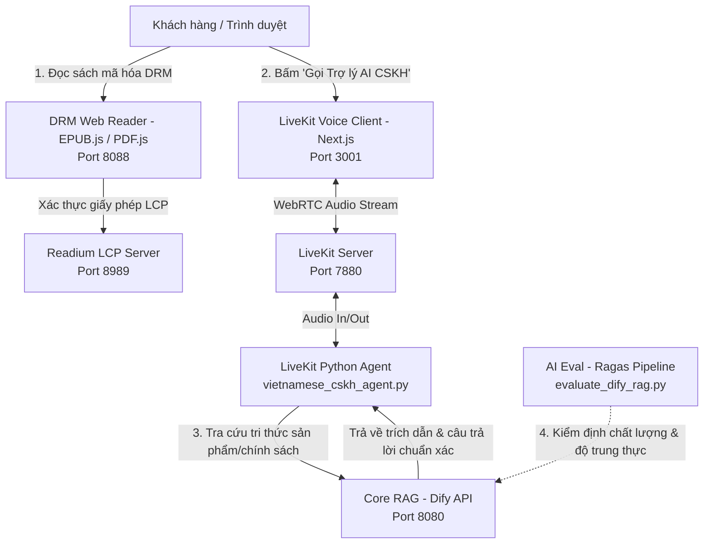

# Ecommerce AI Platform - Kiến Trúc & Vận Hành Thống Nhất Trên Localhost

Hệ thống kết hợp 4 trụ cột công nghệ tạo thành một nền tảng thương mại điện tử nội dung số (E-book / Digital Content) tích hợp Trợ lý thoại AI CSKH thông minh:



---

## 1. Cách các phân hệ hoạt động thống nhất với nhau

1. **Core RAG (`core-rag/dify`) - Bộ Não Tri Thức Tập Trung**:
   - Chạy trên cổng `http://localhost:8080`.
   - Lưu trữ toàn bộ dữ liệu: Danh mục sách điện tử, nội dung trích đoạn, chính sách bán hàng, đổi trả, bảo hành bản quyền DRM.
   - Cung cấp API (`/v1/chat-messages` và `/v1/datasets/{id}/retrieve`) cho các dịch vụ khác truy vấn.

2. **Voice Agent (`voice-agent`) - Giao Diện Tổng Đài CSKH Bằng Giọng Nói Tiếng Việt**:
   - **`LiveKit Server`** (Cổng 7880): Đảm nhiệm trung chuyển luồng âm thanh thời gian thực (WebRTC).
   - **`Frontend` (Next.js - Cổng 3001)**: Giao diện web cho khách hàng bấm "Gọi Trợ lý CSKH", tích hợp hiệu ứng sóng âm thanh (visualizer) và hiển thị phụ đề thời gian thực.
   - **`Backend` (Python Worker - `vietnamese_cskh_agent.py`)**: Nhận dạng giọng nói tiếng Việt khách hàng (STT). Khi khách hỏi về giá sách, quyền đọc, hoàn tiền, agent tự động kích hoạt function calling gọi sang **Dify RAG** để lấy câu trả lời chính xác, sau đó phát âm thanh tiếng Việt (TTS) phản hồi ngay lập tức.

3. **DRM & Reader Security (`drm-security`) - Bảo Mật Ấn Phẩm & Đọc Trực Tuyến**:
   - **`readium-lcp-server`**: Quản lý khóa mã hóa ấn phẩm và sinh giấy phép đọc (`.lcpl`).
   - **`epub.js` & `pdf.js`**: Được tích hợp vào cổng đọc trực tuyến `reader-portal` (Cổng 8088). Người dùng đọc sách trực tiếp trên trình duyệt mà không tải được file gốc ra ngoài.
   - Tại màn hình đọc sách, luôn có nút bấm nổi **"Gọi Trợ lý AI CSKH"** liên kết trực tiếp sang Voice Agent để hỗ trợ độc giả tức thì.

4. **AI Evaluation (`ai-eval/ragas`) - Giám Sát & Đánh Giá Chất Lượng**:
   - Đo lường các chỉ số quan trọng: `Faithfulness` (Độ trung thực, chống ảo giác/bịa đặt giá tiền), `Answer Relevancy` (Độ liên quan câu trả lời) dựa trên tập dữ liệu kiểm thử.
   - Giúp đảm bảo các câu trả lời do Dify sinh ra cho Voice Agent đạt tiêu chuẩn trước khi đưa vào sản xuất.

---

## 2. Bảng Phân Bổ Cổng (Port Mapping)

Để không xung đột với các dịch vụ đang chạy trên máy (như Saleor/AuraBook trên cổng 8000, 9000, 5432, 6379, 3000):

| Dịch vụ | Cổng Localhost | Vai trò |
|---|---|---|
| **Dify RAG (Nginx)** | `http://localhost:8080` | Quản lý kho tri thức, Prompt, API Dify |
| **LiveKit Server** | `http://localhost:7880` & `ws://localhost:7880` | Máy chủ WebRTC Voice Agent |
| **Voice Agent Web** | `http://localhost:3001` | Giao diện Next.js gọi thoại CSKH |
| **DRM Web Reader** | `http://localhost:8088` | Giao diện đọc sách EPUB/PDF bảo mật |
| **Readium LCP Server** | `http://localhost:8989` | Cấp phép và mã hóa bản quyền sách |

---

## 3. Hướng Dẫn Khởi Chạy Từng Bước

### Bước 1: Khởi động các dịch vụ nền tảng (Docker)
Chạy script PowerShell đã tạo sẵn:
```powershell
cd ecommerce-ai-platform
.\start-platform.ps1
```
*Script sẽ tự động khởi động Dify RAG, LiveKit Server và Web Reader Gateway.*

### Bước 2: Thiết lập và lấy API Key từ Dify
1. Mở trình duyệt vào `http://localhost:8080/install` để tạo tài khoản Admin ban đầu.
2. Vào mục **Studio** -> Tạo một ứng dụng **Chatbot** hoặc **Agent** mang tên "CSKH Sách Điện Tử".
3. Vào mục **Knowledge** -> Tải tài liệu về chính sách bán sách, điều khoản DRM lên để Dify lập chỉ mục vector.
4. Vào ứng dụng vừa tạo -> Mục **API Access** -> Bấm **Generate API Key** (ví dụ: `app-xxxx`).
5. Dán key này vào file `ecommerce-ai-platform/voice-agent/backend/.env`:
   ```env
   DIFY_API_KEY=app-xxxx
   ```

### Bước 3: Khởi chạy Voice Agent Frontend
```powershell
cd ecommerce-ai-platform/voice-agent/frontend
npm install
npm run dev -- -p 3001
```
Truy cập `http://localhost:3001` để trải nghiệm giao diện gọi thoại.

### Bước 4: Khởi chạy Voice Agent Backend Worker
Mở một cửa sổ Terminal mới:
```powershell
cd ecommerce-ai-platform/voice-agent/backend
python -m venv .venv
.\.venv\Scripts\activate
pip install livekit-agents livekit-plugins-openai livekit-plugins-deepgram aiohttp python-dotenv
python vietnamese_cskh_agent.py dev
```

### Bước 5: Kiểm định độ chính xác RAG
```powershell
cd ecommerce-ai-platform/ai-eval
python evaluate_dify_rag.py
```
